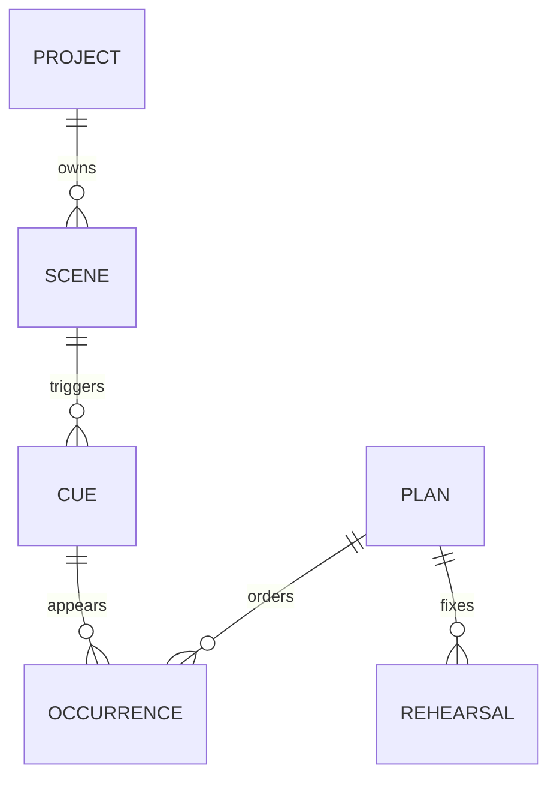

# 领域与本体设计

## 专业聚合

Evidence固定引文、Scene排演段落、Cue部门提示、Plan提示编排、Occurrence调用出场、Rehearsal固定排演记录、Note意见。根字段：evidence、scenes、cues、plans、rehearsals、notes、basis_refs。专业对象以WorkRef＋owner_plugin_id＋object_id确定身份，revision＋sha256固定内容。相同标题不代表同一对象。

固定引文只追加。提示绑定明确段落和触发说明，部门与调用依赖可核对；依赖循环、出场ID或顺序重复和计划中倒置依赖拒绝；同一提示可有多个独立出场。计划固定实际使用的段落、提示及顺序组合摘要；改稿后旧计划与意见待复核。排演记录包含完整专业快照，旧记录不可覆盖，手动记录的时间与结果不冒充设备回执。估时和现场手记分列；不以计划完成认定演出完成。

所有集合ID唯一、所有引用存在、集合有界、顺序在对应父级唯一。撤销先处理依赖，不能制造悬空引用；来源索引只追加，整本保存不能改变原索引意义。跨包引用只携带固定Owner、对象、修订与摘要，通过公开SDK回读，不导入对方私有结构。

## 权属

原始资料、作品身份与受管事务归Core；专业记录归本包；理解、创作与解释归作者选择的外部Agent；表达取舍与定稿归作者。借助欧卡姆原理复用通用事实，只增加本旅程需要的专业状态。
