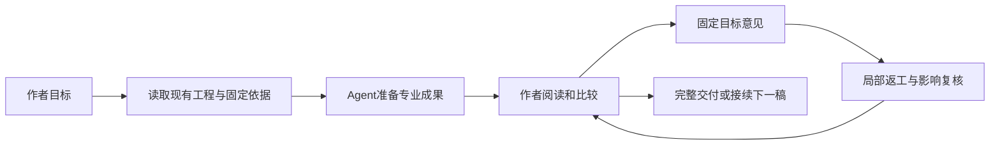

# 工作面与交互设计

独立页面紧凑顶部提供返回作品、刷新和让AI处理。五页：提示本阅读、段落与部门、调用与排演、意见与复核、排演交付。阅读与具体依据优先，结构与技术标识按需展开；完整JSON只作为高级维护入口，不成为默认创作步骤。

示例：“把旧站舞台片段做成灯光、声音和换景提示本，检查调用先后；保留一次手动排演记录，改台词后复核旧计划。”Agent准备结构，作者连贯阅读、比较与提意见。允许选择所有已有目标，不只支持首篇或首段；意见固定目标摘要。各页交接带当前对象与修订，空状态说明缺少的材料和下一步。

Radix语义色、连续静止的纸色玉色渐变、实色文稿与输入、0.5px边框、12／14／18／20px以内四档、可辨识键盘焦点与减少透明度降级。后台报告不覆盖用户操作反馈；unknown保留原键，CAS保留未保存输入，关闭重开恢复原草稿。

实际页面循环核对布局、间距、排版、颜色、状态和交互；记录画面与尺寸，六项9分是设计判断，不冒充像素认证。真实行为验收必须包括选择目标、导出原字节、取消、冲突、明确新基线及关闭恢复。
